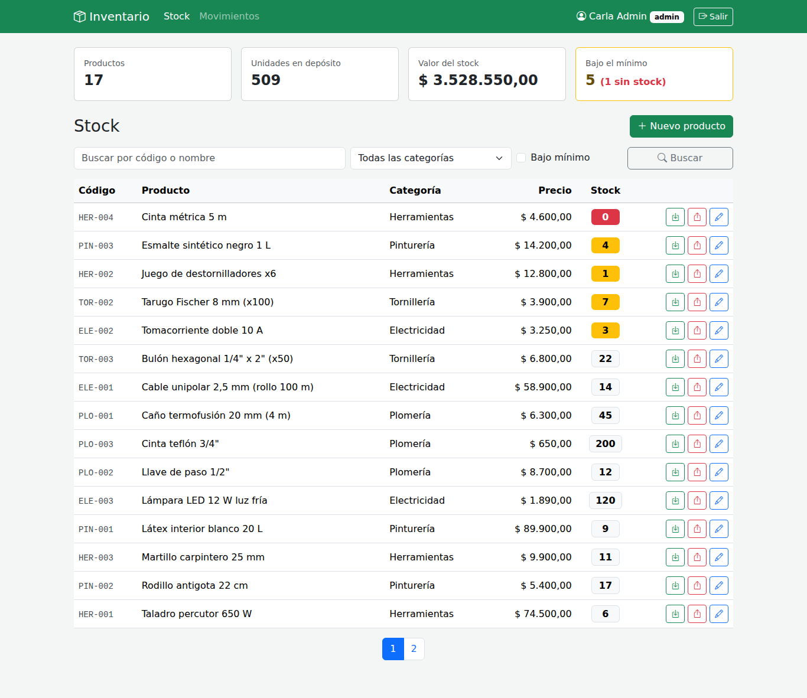
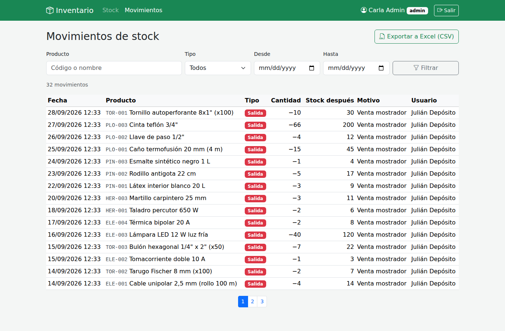
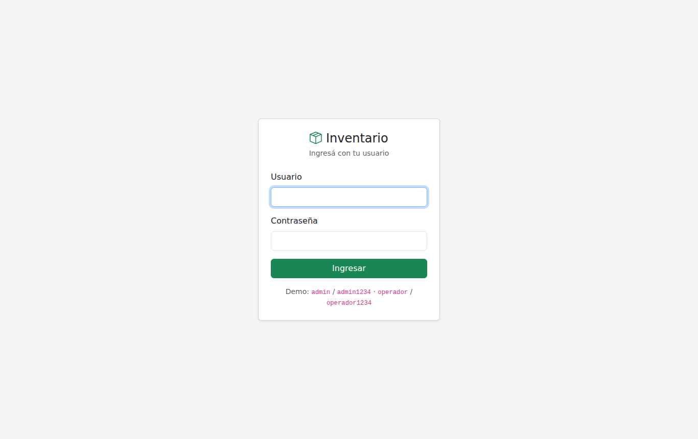

# Inventario y control de stock

🇬🇧 [Read in English](README.en.md)

Sistema de stock para un comercio (la demo es una ferretería), hecho en **PHP sin frameworks** (compatible con PHP 5.6 a 8.x), **MySQL**, **Bootstrap 5**, **jQuery** y **Ajax**.

## Funcionalidades
- **Tablero** con cantidad de productos, unidades en depósito, valor del stock y productos bajo el mínimo, calculados en una sola consulta SQL.
- **Listado de stock** con búsqueda por código o nombre, filtro por categoría y por "bajo mínimo", y paginación. Los productos a reponer aparecen primero y se marcan en amarillo (o rojo si no hay stock).
- **Entradas y salidas por Ajax:** un modal registra el movimiento con jQuery y la fila se actualiza sin recargar la página.
- **Historial de movimientos** con filtros por producto, tipo y rango de fechas, mostrando quién hizo cada cambio y cómo quedó el stock (`JOIN` entre movimientos, productos y usuarios).
- **Exportación a Excel (CSV)** de los movimientos filtrados.
- **Roles:** el administrador da de alta y edita productos; el operador de depósito solo consulta y registra movimientos.

## Decisiones de diseño
| Decisión | Por qué |
|---|---|
| El stock solo cambia con movimientos | Al editar un producto no se puede tocar el stock. Así cada unidad que entra o sale queda registrada con usuario, fecha y motivo, y el historial siempre cierra con el stock actual. |
| Stock inicial como primer movimiento | El alta de un producto con stock registra una "entrada" automática, dentro de la misma transacción. |
| Salida con `UPDATE ... SET stock = stock - ? WHERE id = ? AND stock >= ?` | Si dos operadores venden la última unidad al mismo tiempo, la base acepta solo una de las dos salidas. Leer el stock, restar en PHP y guardar permitiría quedar en negativo. |
| Transacciones (`beginTransaction` / `commit` / `rollBack`) | El cambio de stock y su registro en el historial se guardan juntos o no se guarda ninguno. |
| CSV con `;` y BOM UTF-8 | Es lo que espera Excel con configuración regional argentina para separar columnas y mostrar bien los acentos. |
| Celdas del CSV que empiezan con `=`, `+`, `-` o `@` llevan un `'` adelante | Evita la inyección de fórmulas en Excel si alguien carga un motivo malicioso. |

## Seguridad
| Riesgo | Cómo se resuelve |
|---|---|
| Inyección SQL | Todas las consultas son preparadas con PDO; los comodines de `LIKE` se escapan. |
| XSS | Toda salida pasa por `htmlspecialchars` (función `e()`); el JavaScript usa `.text()`, nunca `.html()`, con datos del servidor. |
| CSRF | Token por sesión en cada formulario y en cada pedido Ajax. |
| Permisos | `requiere_admin()` en las pantallas de productos; el endpoint Ajax exige sesión y responde 401 en JSON si expiró. |
| Contraseñas | `password_hash` / `password_verify`, regeneración de sesión y bloqueo de 5 minutos después de 5 intentos fallidos. |
| Archivos internos | `.htaccess` deniega `includes/`, `data/`, `sql/` y `tests/`. |

## Casos de uso documentados
| # | Caso | Resultado esperado |
|---|---|---|
| 1 | Operador registra una salida de 5 unidades con stock 14 | La fila pasa a 9 sin recargar; aparece un aviso de confirmación. |
| 2 | Salida de 15 unidades con stock 14 | No se registra; el modal muestra "Stock insuficiente: hay 14 unidades". |
| 3 | Salida que deja el stock igual o debajo del mínimo | La fila se pinta de amarillo (rojo si queda en 0). |
| 4 | Operador entra a `producto.php` | Responde 403. |
| 5 | Admin edita un producto | Puede cambiar código, nombre, precio y mínimo, pero no el stock. |
| 6 | Alta con un código que ya existe | No guarda; "Ya existe un producto con ese código". |
| 7 | La sesión expira con el modal abierto | El pedido Ajax recibe 401 y redirige al login. |
| 8 | Exportar movimientos filtrados por "Salidas" del último mes | Descarga un CSV que Excel abre con columnas y acentos correctos. |

Los casos 2 y 6, y la lógica de los demás están automatizados en `tests/pruebas.php` (25 pruebas: consultas, movimientos, validaciones e inyección SQL).

## Estructura
```
index.php            Tablero y listado de stock
producto.php         Alta y edición de productos (admin)
movimientos.php      Historial con filtros
exportar.php         Descarga CSV
api/movimiento.php   Endpoint Ajax (JSON) para entradas y salidas
login.php / logout.php
includes/
  config.php         Configuración (lee config.local.php o variables de entorno)
  db.php             Conexión PDO (MySQL, o SQLite en modo demo)
  funciones.php      Sesión, roles, CSRF, JSON, mensajes
  inventario.php     Consultas, transacciones y validaciones
  layout.php         Encabezado y pie comunes
assets/js/app.js     Modal de movimientos y llamada Ajax
sql/schema.sql       Tablas MySQL
sql/crear_usuario.php  Alta de usuarios desde consola
tests/pruebas.php    Pruebas sin dependencias
```

## Cómo correrlo
**Local (modo demo, sin instalar MySQL):**
```bash
php -S localhost:8000
```
Entrar con `admin` / `admin1234` o `operador` / `operador1234`. Se crea `data/demo.sqlite` con 17 productos y su historial.

**Pruebas:**
```bash
php tests/pruebas.php
```

**Servidor con MySQL (ej. InfinityFree):**
1. Ejecutar `sql/schema.sql` en phpMyAdmin.
2. Copiar `includes/config.local.ejemplo.php` como `includes/config.local.php` y completar los datos.
3. Crear el primer usuario: `php sql/crear_usuario.php admin <contraseña> admin "Nombre"` (o desde un entorno local apuntando a la misma base).
4. Subir los archivos a `htdocs/`.

Requiere PHP 5.6 o superior con PDO (`pdo_mysql`, o `pdo_sqlite` para el modo demo).

## Capturas
| Stock | Movimientos | Login |
|---|---|---|
|  |  |  |
